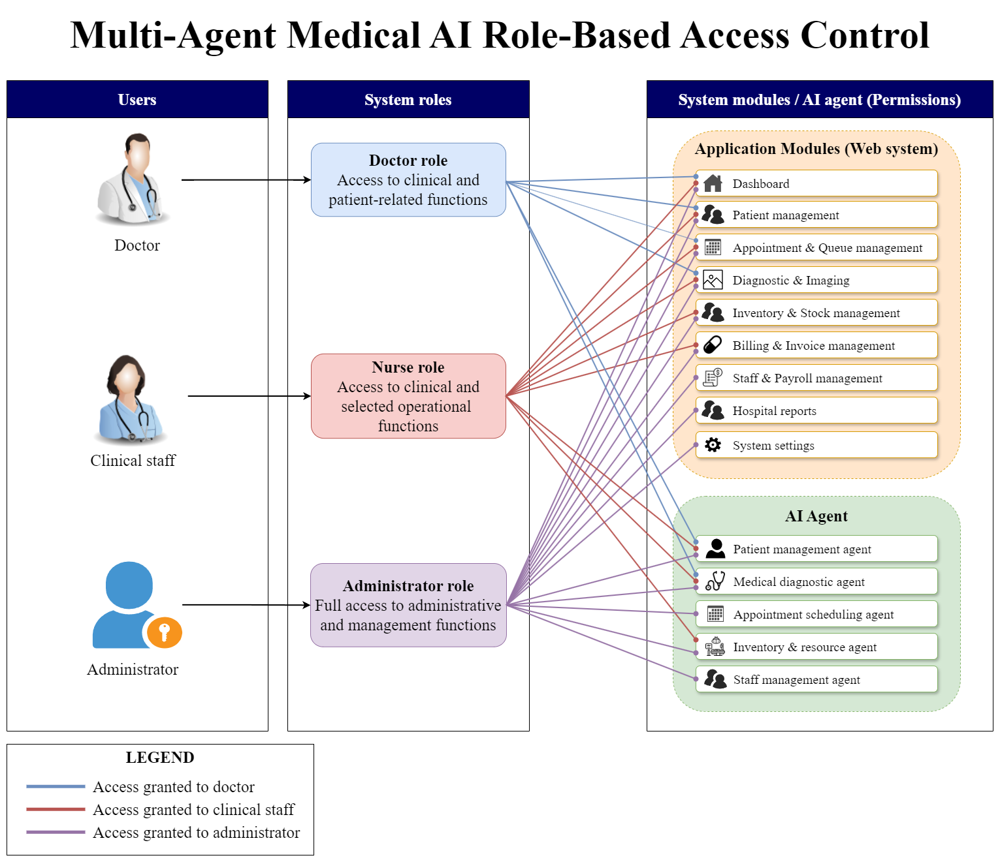

# 🏥 MediSync — Multi-Agent Medical AI System

### Role-Aware Multi-Agent Healthcare Workflows with Persistent Long-Term Memory

**A role-aware healthcare support platform combining specialised AI agents, persistent cross-session memory, and an updatable clinical knowledge base.**

🏆 **Third Place — AUTOCOUNT–FICT FYP Competition (2026)**  
📄 **Accepted for publication — ICNGN 2026 (Paper ID: 235, publication link coming soon~)**

---

## 📌 Project Overview

MediSync is a **production-oriented research prototype** for intelligent healthcare workflow support. Instead of relying on a single medical chatbot, it uses a **central multi-agent orchestrator** to route requests to five specialised agents, while respecting the authenticated user's role and permissions.

Its central focus is **persistent long-term memory**: remembering relevant contextual information, retrieving it in subsequent sessions, and updating it as new information becomes available. An **updatable Retrieval-Augmented Generation (RAG) knowledge base** supplies clinical reference context separately from conversational memory.

The integrated web platform supports **doctors, clinical staff (nurses), and hospital administrators** with selected clinical-support and operational workflows. It is intended to assist human professionals, **not replace clinical judgement**.

### 🎯 Project Objectives

1. Implement persistent, retrievable, and updatable **long-term memory across AI-agent sessions**.
2. Use **specialised AI agents** to assist repetitive clinical and hospital management workflows.
3. Provide a **centralised role-based platform** for relevant healthcare information and workflow coordination.

---

## ✨ Key Features

| Capability | What it does |
| --- | --- |
| 🤖 **Multi-Agent Orchestration** | Classifies requests, selects specialised agents, coordinates tasks/tools, and handles fallbacks. |
| 🧠 **Persistent Long-Term Memory** | Stores, retrieves, and updates relevant context across different conversations and sessions. |
| 📚 **Updatable Clinical RAG** | Retrieves relevant information from indexed clinical references without retraining the LLM. |
| 🔐 **Role-Based Access Control (RBAC)** | Restricts web modules and AI agent actions based on doctor, nurse, or administrator permissions. |
| 🩺 **Clinical Support** | Supports patient records, clinical information retrieval, report summaries, and AI-assisted medical-image interpretation. |
| 📅 **Hospital Operations** | Supports appointments, conflict checks, queues, stock, resources, staff schedules, and reporting. |
| 🖼️ **Multimodal Interaction** | Accepts supported text and image inputs in the conversational interface. |
| 🧾 **Traceability & Recovery** | Includes conversation logging, agent tracing, and fallback handling. |

---

## 🧩 Specialised AI Agents

A **Supervisor / Multi-Agent Orchestrator** coordinates five specialist agents:

| Agent | Core responsibilities |
| --- | --- |
| 👤 **Patient Management Agent** | Patient profiles, case history, medication information, vital signs, and treatment-plan support. |
| 🩻 **Medical Diagnostics Agent** | Report analysis, image-interpretation assistance, diagnostic summaries, and clinical-review support. |
| 📅 **Appointment Scheduling Agent** | Appointment booking and changes, conflict detection, reminders, and queue support. |
| 📦 **Inventory & Resource Agent** | Stock availability, low-stock/expiry alerts, beds, rooms, and resource management. |
| 👥 **Staff Management Agent** | Staff records, shifts, attendance, payroll-related information, and management reporting. |

The orchestrator checks permissions before allowing an agent or protected operation to execute.

---

## 🏗️ Overall System Architecture

*Overall system architecture: user/interface layer, AI orchestration and specialised agents, memory and knowledge, and application/data services.*

The platform connects a **Next.js + TypeScript** user interface with **Python / FastAPI** services and the **LangChain / LangGraph** multi-agent framework. An orchestrator prepares context and coordinates tools, retrieval, and responses. Supporting components include **PostgreSQL**, **Redis**, **ChromaDB**, and **Mem0**.

---

## 🔐 Role-Based Access Control (RBAC)

*Application-module and AI-agent permissions for doctors, clinical staff, and administrators.*

RBAC applies to **both the web application and specialised AI-agent operations**. Different roles receive different access to patient-facing, clinical, and administrative capabilities. Requests outside a user's permissions are denied or handled through a controlled fallback.

---

## 📚 Retrieval-Augmented Generation (RAG) Pipeline

*RAG Pipeline: Document parsing, chunking, embedding and indexing, retrieval, context construction, and response generation.*

The system maintains a **separate, updatable clinical knowledge base**. Its document ingestion and question-answering workflow:

1. **Ingestion:** Parse documents and split clinical text into retrievable sections or chunks.
2. **Indexing:** Generate embeddings and store document vectors in **ChromaDB**.
3. **Query:** Load the user question together with relevant role and session context.
4. **Retrieval:** Search the indexed clinical knowledge for relevant passages.
5. **Context construction:** Assemble retrieved evidence and the user question into an LLM prompt.
6. **Response:** Generate a context-grounded answer and log applicable interaction context.

The design also incorporates retrieval tools such as **DocumentRAG, GraphRAG, and TableRAG** within the wider agent framework.

---

## 🧠 Three-Layer Long-Term Memory Architecture

*Session memory, persistent relational conversation history, and long-term semantic memory with post-turn write-back.*

| Layer | Technology | Purpose |
| --- | --- | --- |
| **L1 · Short-term working memory** | **Redis** | Fast access to recent active session context and cached conversational turns. |
| **L2 · Persistent relational history** | **PostgreSQL** | Durable chat sessions, messages, and associated metadata. |
| **L3 · Long-term semantic memory** | **Mem0 + ChromaDB** | Extraction, storage, retrieval, and updating of relevant cross-session facts and preferences. |

Relevant context is assembled before an agent handles a new request. After a response, an **asynchronous write-back process** updates applicable session, relational, and semantic memory stores. The architecture includes user-/patient-/role-aware contextual separation and safeguards designed to reduce irrelevant or sensitive memory retention.

**Important distinction:** **RAG retrieves external clinical reference knowledge; long-term memory preserves information from prior interactions.** Both can inform a request, but they serve different roles.

---

## 🛠️ Technology Stack

| Area | Technologies |
| --- | --- |
| **Frontend** | Next.js, TypeScript |
| **Backend** | Python, FastAPI |
| **Agent orchestration** | LangChain, LangGraph |
| **LLM & embeddings** | OpenAI API, GPT-4o mini, `text-embedding-3-large` |
| **Persistent memory** | Mem0 |
| **Data stores** | PostgreSQL, Redis, ChromaDB |
| **Database integration** | SQLAlchemy, AsyncPG |
| **Background execution** | Celery, Redis, Python asyncio |
| **Authentication** | Auth0 |
| **Observability** | LangSmith, Python logging |
| **Supporting integrations** | Resend API, Google Calendar API, Stripe, PDF processing tools |

---

## 🧪 Evaluation Highlights

The prototype was evaluated through **tool-level, task-level, and turn-level functional testing**, as well as non-functional measurements for latency, token usage, and response accuracy.

| Non-functional test level | Cases | Mean latency | Avg. tokens | Correct responses |
| --- | ---: | ---: | ---: | ---: |
| Tool-level | 10 | 0.042 s | 43.3 | 10/10 |
| Task-level | 10 | 0.551 s | 421.9 | 10/10 |
| Turn-level | 10 | 0.621 s | 496.0 | 10/10 |
| **Overall** | **30** | **0.405 s** | **320.4** | **30/30** |

The defined tests demonstrated specialist routing, workflow coordination, RAG-supported retrieval, and cross-session memory retention and updating. **The 100% result applies only to the 30 selected non-functional evaluation cases under their predefined criteria**; it is not a claim of real-world clinical diagnostic accuracy or hospital production validation.

---

## 🎬 System Demonstration

Explore MediSync in action through the full system walkthrough, featuring the role-aware healthcare interface and multi-agent workflow demonstration.

  

<a href="https://youtu.be/050RG-sDlCA"><strong>▶ Watch the Full MediSync System Demo on YouTube</strong></a>

---

## ⚠️ Scope & Disclaimer

> **Research / demonstration prototype only.** MediSync has **not** been deployed as a live hospital system or clinically validated for autonomous patient care. Its diagnostic, image-analysis, medication, and treatment-related outputs are preliminary **decision-support information** requiring review by qualified healthcare professionals. The project does not claim regulatory certification or integration with real patient databases.

---

---

**🏆 Award-winning Final Year Project**

**📄 ICNGN 2026 International Conference Accepted Paper**

*Persistent memory. Specialised agents. Context-aware healthcare support.*

